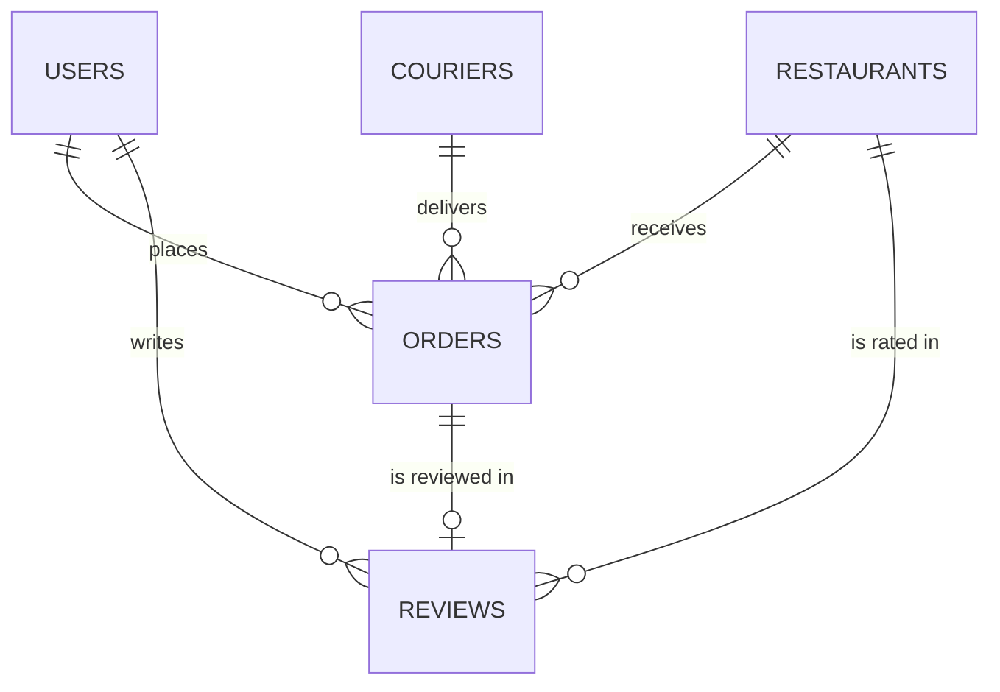

# Data Model

Five collections in the `food_delivery` database. Example documents use synthetic data located in **Berlin**.

> GeoJSON coordinates are always `[longitude, latitude]` — longitude first.



## Embed vs reference — summary

| Data | Decision | Why |
|---|---|---|
| `users.addresses` | embed | A user has only a few addresses (bounded), and they are always read together with the user. |
| `restaurants.menu` | embed | The menu is bounded and always read together with the restaurant. |
| `orders.items` | embed (snapshot) | Menu prices can change later, and an order must keep the price at the time of purchase; otherwise old receipts and revenue reports would change. |
| `orders.statusHistory` | embed | An order has at most ~6 statuses (bounded), and they are always shown together on the order tracking page. |
| `orders.deliveryAddress` | embed (snapshot) | The customer can change the address later, and the order must keep the address at the time of purchase. |
| `orders` → user / restaurant / courier | reference | A customer has many orders; if the customer's phone number were copied into each order, every order would need an update when it changes. Users, restaurants and couriers are also read independently. |
| `reviews` | separate collection | Reviews can grow without limit, and every time you open a restaurant page, it would load all of its reviews. |

Rule of thumb used for every decision:

1. Is the data always read together with its parent? → embed
2. Can it grow without limit? (a document is limited to 16 MB) → reference
3. Is it read or updated independently? → reference

## `users`

```js
{
  _id: ObjectId("..."),
  name: "Lena Fischer",
  email: "lena.fischer@example.de",
  phone: "+49 30 1234567",
  createdAt: ISODate("2026-03-14T09:12:00Z"),
  addresses: [
    {
      label: "home",
      street: "Oranienstraße 25",
      postalCode: "10999",
      city: "Berlin",
      location: { type: "Point", coordinates: [13.4237, 52.5005] }
    }
  ]
}
```

## `restaurants`

```js
{
  _id: ObjectId("..."),
  name: "Kreuzberg Döner",
  cuisine: "turkish",
  address: { street: "Kottbusser Damm 10", postalCode: "10967", city: "Berlin" },
  location: { type: "Point", coordinates: [13.4180, 52.4990] },
  openingHours: [
    { day: 1, open: "10:00", close: "23:00" }   // day: 1 = Monday … 7 = Sunday
  ],
  menu: [
    { name: "Döner Kebab", category: "main", price: NumberDecimal("8.50"), available: true },
    { name: "Ayran",       category: "drink", price: NumberDecimal("2.00"), available: true }
  ]
}
```

## `couriers`

```js
{
  _id: ObjectId("..."),
  name: "Jonas Weber",
  phone: "+49 151 2345678",
  vehicle: "bike",                 // bike | scooter | car
  status: "available",             // offline | available | delivering
  currentLocation: { type: "Point", coordinates: [13.4100, 52.5020] },
  locationUpdatedAt: ISODate("2026-10-13T12:30:00Z")
}
```

## `orders`

```js
{
  _id: ObjectId("..."),
  userId: ObjectId("..."),          // reference → users
  restaurantId: ObjectId("..."),    // reference → restaurants
  courierId: ObjectId("..."),       // reference → couriers (null until assigned)
  items: [                          // snapshot of the menu at order time
    { name: "Döner Kebab", unitPrice: NumberDecimal("8.50"), quantity: 2 },
    { name: "Ayran",       unitPrice: NumberDecimal("2.00"), quantity: 1 }
  ],
  totalAmount: NumberDecimal("19.00"),
  deliveryAddress: {                // snapshot of the user's address at order time
    street: "Oranienstraße 25",
    postalCode: "10999",
    city: "Berlin",
    location: { type: "Point", coordinates: [13.4237, 52.5005] }
  },
  status: "delivered",              // current status, duplicated for fast filtering
  statusHistory: [
    { status: "placed",     at: ISODate("2026-10-13T12:00:00Z") },
    { status: "preparing",  at: ISODate("2026-10-13T12:03:00Z") },
    { status: "on_the_way", at: ISODate("2026-10-13T12:18:00Z") },
    { status: "delivered",  at: ISODate("2026-10-13T12:31:00Z") }
  ],
  createdAt: ISODate("2026-10-13T12:00:00Z")
}
```

## `reviews`

```js
{
  _id: ObjectId("..."),
  orderId: ObjectId("..."),         // one review per order
  userId: ObjectId("..."),
  restaurantId: ObjectId("..."),
  rating: 5,                        // 1–5
  comment: "Fast delivery, still hot.",
  createdAt: ISODate("2026-10-13T13:05:00Z")
}
```

## Money

All money fields use `Decimal128`, because it stores exact decimal values. `double` is binary floating point, so `0.1 + 0.2` returns `0.30000000000000004`, and small errors add up in revenue sums.
